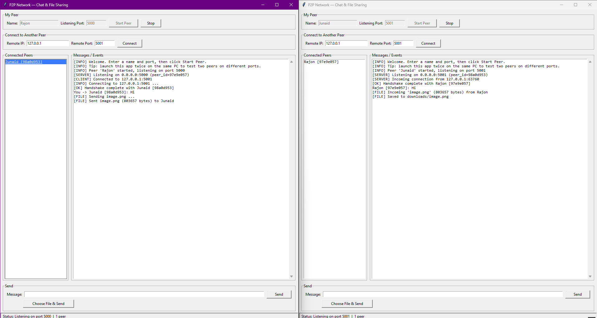

# P2P Network Communication and File Sharing

A lightweight **Peer-to-Peer** desktop application written in Python.
Each running instance is a **peer** that can act as **both** a TCP
server (accepting incoming connections) and a TCP client (initiating
outgoing connections).

There is **no central server**.

The project is intentionally small. It exists so that the author (and
anyone reading the code) can clearly explain, line by line, how
peer-to-peer communication over TCP works: sockets, ports, threads,
handshakes, message framing, and chunked file transfer.

---

## Features

- Start a peer with a chosen **name** and **listening port**.
- Connect to any other peer by **IP** + **port**.
- **HELLO / HELLO_ACK** handshake so both sides learn each other's
  identity (`peer_id`, `peer_name`, `port`).
- Live **Connected Peers** list.
- **Text messaging** between any two connected peers.
- **Binary file transfer** for any file type (`.txt`, images, audio,
  video, PDFs, ZIPs, etc.) using a single chunked protocol.
- **Multiple concurrent peers** — every connection runs in its own
  thread.
- Simple **Tkinter** GUI.
- Basic **error handling** so the app does not crash when a peer
  disconnects.

---

## Requirements

- Python **3.9+**
- No third-party packages. The app uses only the standard library
  (`socket`, `threading`, `json`, `struct`, `uuid`, `os`, `tkinter`).

---

## Installation

Clone or download the project, then `cd` into it:

```bash
cd P2P_Network
```

There is nothing to install.

---

## Run

```bash
python main.py
```

The Tkinter window opens. You can launch it as many times as you want —
each launch is one peer.

---

## Usage

1. **Start a peer.** Enter a `Name` (e.g. `Alice`) and a `Port`
   (e.g. `5000`) and click **Start Peer**.
2. **Start a second peer.** Launch `python main.py` again. Enter a
   different name and port (e.g. `Bob`, `5001`). Click **Start Peer**.
3. **Connect them.** In Bob's window, type `127.0.0.1` for IP and
   `5000` for port, then click **Connect**. Both windows will show the
   other peer in the **Connected Peers** list.
4. **Send a text message.** Click a peer in the list to select them,
   type a message, and press **Send**.
5. **Send a file.** With a peer selected, click **Choose File & Send**
   and pick any file (image, audio, video, PDF, anything). It is saved
   into the other peer's `downloads/` folder.

---

## Testing

### 1. Same computer

Open two instances of the app:

- Alice on port `5000`
- Bob   on port `5001`

In Bob's window, click Connect with IP `127.0.0.1` and port `5000`.
Send text both ways and send a small file.

### 2. Two computers on the same LAN

- Computer A: Alice, port `5000`, IP `192.168.1.10`
- Computer B: Bob,   port `5001`, IP `192.168.1.11`

Make sure your firewall allows inbound traffic on the chosen port.
On Windows you may need to allow the app through *Windows Defender
Firewall*.

Bob connects to `192.168.1.10:5000`.

### 3. Three or more peers

Start three peers on three different ports, e.g.:

- Alice   port `5000`
- Bob     port `5001`
- Charlie port `5002`

Have Bob connect to Alice, and Charlie connect to Alice (or to Bob).
You should see all of them in each other's Connected Peers list. Try
sending text and files between different pairs.

---

## Project Structure

```text
P2P_Network/
├── main.py          # Tkinter GUI
├── p2p_node.py      # TCP server, client, threads, handshake
├── protocol.py      # JSON message framing + chunked file I/O
├── requirements.txt # No third-party packages
├── README.md
└── downloads/       # Received files are saved here
```

### What lives where

- **`protocol.py`** — only message format and byte-stream helpers.
  No sockets or threads here. Defines `send_message`, `recv_message`,
  `recv_exact`, `send_file`, `recv_file`.
- **`p2p_node.py`** — `P2PNode` class that runs the listening socket,
  accepts incoming connections, opens outgoing ones, runs the HELLO
  handshake in a thread per peer, and sends text/files. It does not
  know anything about Tkinter; it calls callbacks.
- **`main.py`** — Builds the Tkinter GUI and wires the buttons to the
  `P2PNode` callbacks. Uses `root.after(...)` so that networking
  threads update the GUI safely.

---

## How messages are framed (TCP bytes -> messages)

TCP is just a stream of bytes. There is no built-in "end of message"
marker. So we always send a small header first:

```
[4-byte length][JSON payload]
```

- The first 4 bytes are the length of the JSON payload, big-endian
  (`struct.pack("!I", n)`).
- The next N bytes are the JSON text.

The receiver:

1. Reads exactly 4 bytes -> decodes the length `N`.
2. Reads exactly `N` more bytes -> decodes JSON.

This is implemented in `protocol.recv_message` and
`protocol.send_message`.

### File transfer

Because a file is just bytes (not JSON), we send it in two stages on
the **same** socket:

1. A framed JSON metadata message:
   ```json
   {"type":"file","filename":"photo.jpg","filesize":2456789,
    "sender_id":"...","sender_name":"..."}
   ```
2. The raw file bytes, in 64 KB chunks, no framing.

The receiver reads exactly `filesize` bytes after the metadata and
writes them into `downloads/`. This means **one `recv()`
call never has to equal one complete file**.

Important: only the per-connection thread reads from the socket while
a file transfer is in progress. The GUI is notified only when the file
has actually been saved to disk. This avoids the classic race where two
threads call `recv()` on the same socket and the bytes are split
between them in an unpredictable order.

---

## HELLO Handshake

When a TCP connection is opened, both peers send a `hello` JSON
message immediately and reply with `hello_ack`:

```json
{ "type":"hello", "peer_id":"a83f21c4", "peer_name":"Alice", "port":5000 }
```

```json
{ "type":"hello_ack", "peer_id":"92bd71e3", "peer_name":"Bob", "port":5001 }
```

After both sides have exchanged these, each peer knows the other's
`peer_id`, `peer_name`, and `port`, and the GUI adds them to the
**Connected Peers** list.

---



